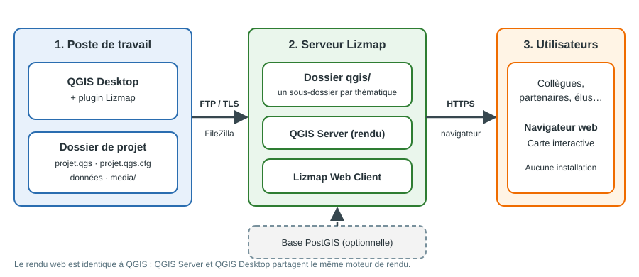
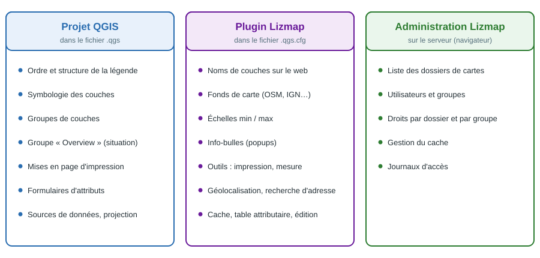
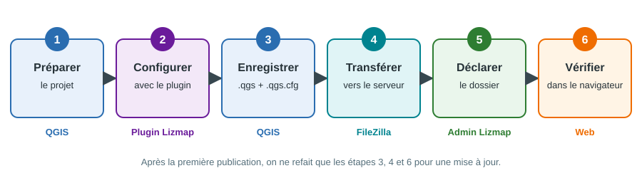
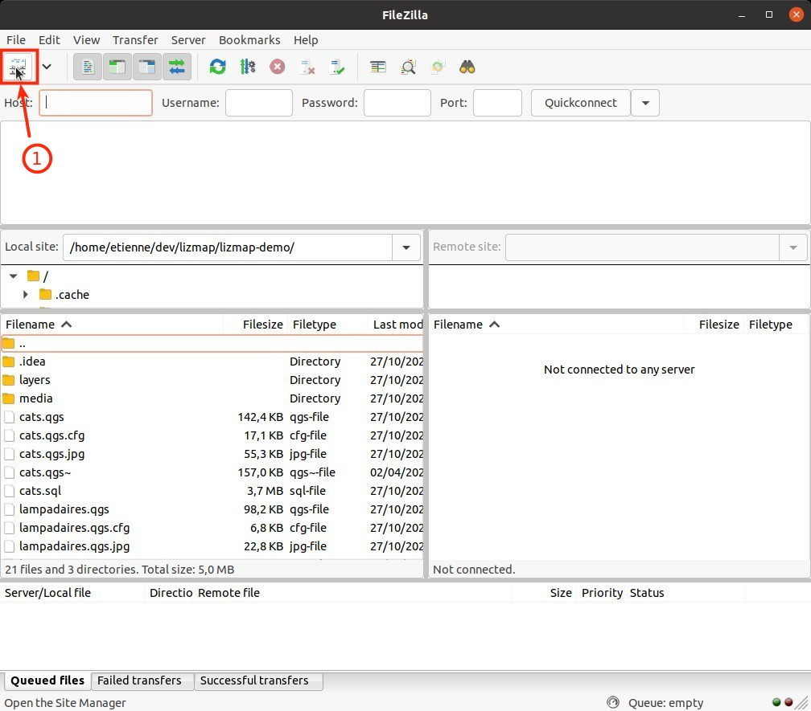
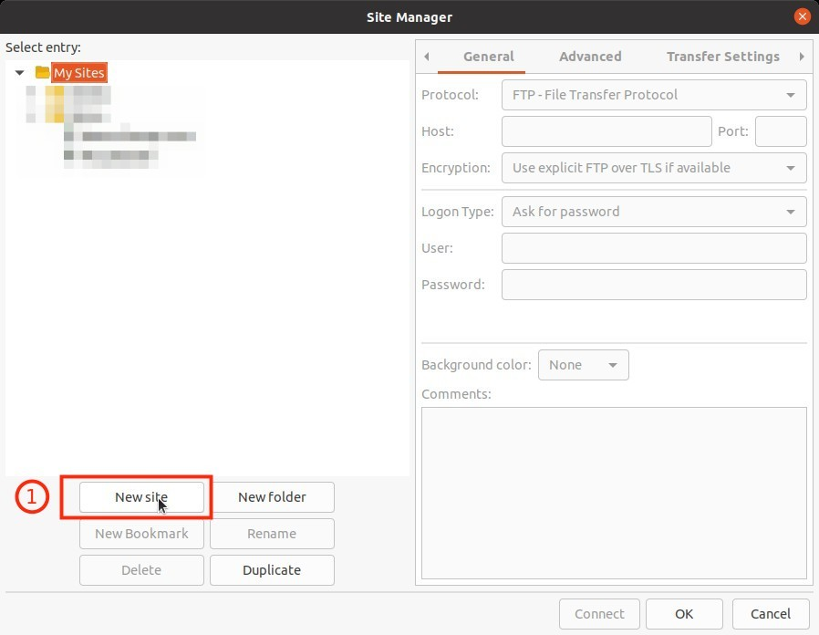
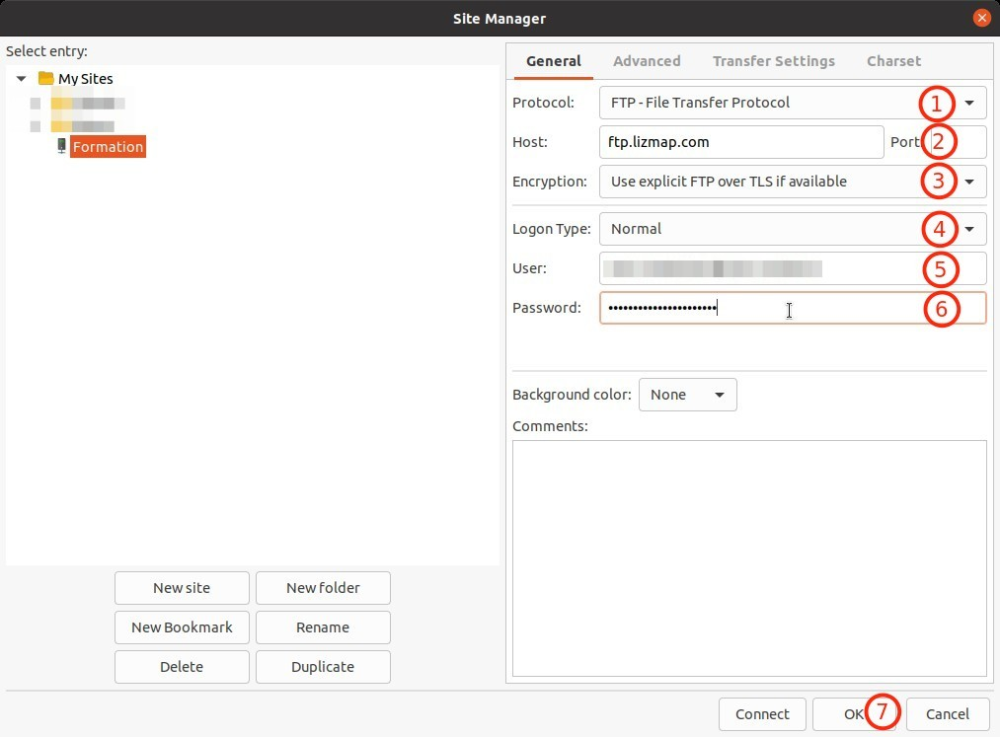
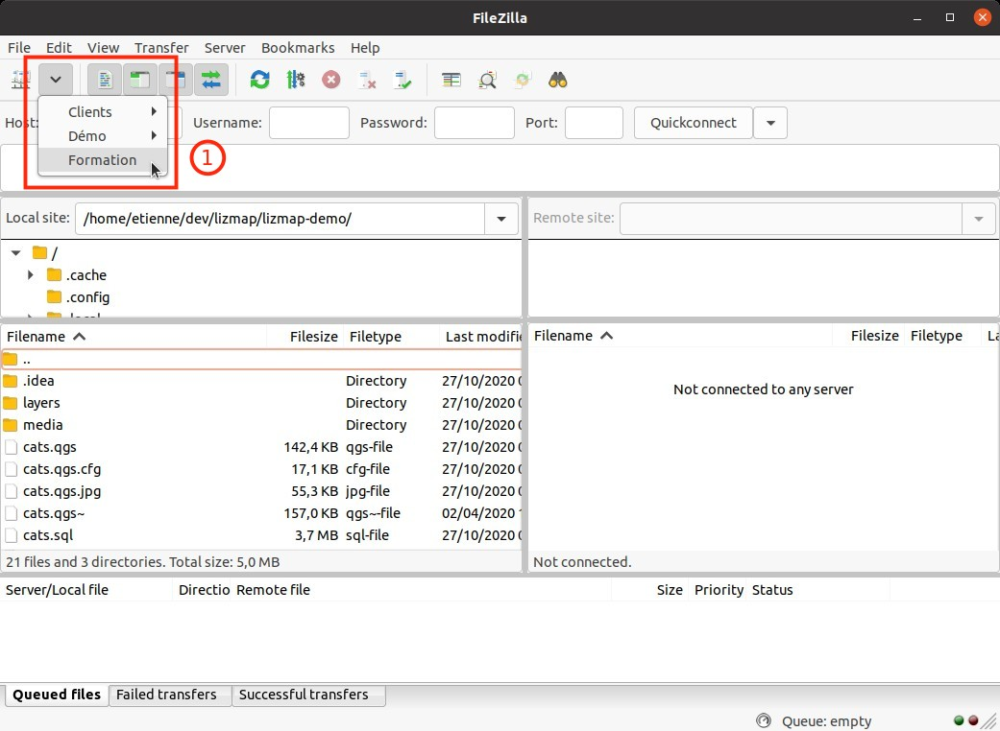
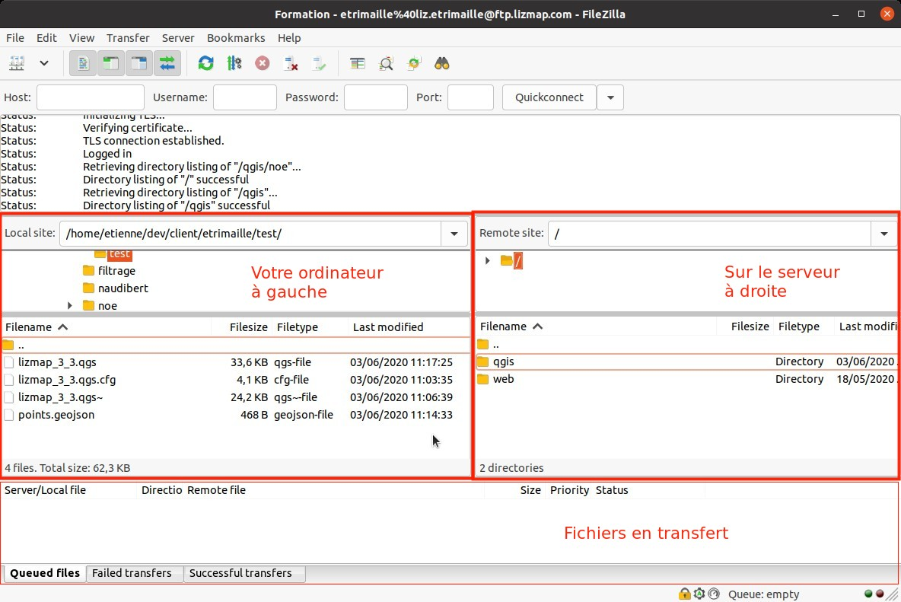

# Publier un projet QGIS sur Lizmap : guide pas à pas

> **Public visé** : les agents de l'AUDC 51 qui utilisent déjà QGIS et qui vont publier leurs cartes sur le web.
> **Durée de lecture** : 25 minutes. **Durée de la première publication** : 1 à 2 heures, puis 10 minutes pour chaque mise à jour.
> **Prérequis** : savoir ajouter des couches dans QGIS, ouvrir une table attributaire et les propriétés d'une couche. Aucune compétence en programmation n'est nécessaire.

---

## 1. À propos de ce guide

### 1.1 Objectif

À la fin de ce guide, vous saurez :

- expliquer ce que fait Lizmap et ce qui reste à faire dans QGIS ;
- préparer un projet QGIS qui fonctionnera sur le web ;
- configurer la publication avec le plugin Lizmap ;
- envoyer le projet sur le serveur avec FileZilla ;
- rendre la carte visible aux bonnes personnes ;
- diagnostiquer les problèmes les plus courants.

### 1.2 Informations propres à l'AUDC

Ces informations sont à compléter une fois pour toutes par la personne qui administre Lizmap. Elles sont ensuite réutilisées dans tout le guide.

| Information | Valeur |
|---|---|
| Adresse de la carte (Lizmap) | `https://[À COMPLÉTER]` |
| Adresse de l'administration | `https://[À COMPLÉTER]/admin.php` |
| Serveur FTP (hôte) | `[À COMPLÉTER]` |
| Port FTP | `[À COMPLÉTER]` (laisser vide pour la valeur par défaut) |
| Version de QGIS à utiliser | `[À COMPLÉTER]` (version LTR recommandée) |
| Référent Lizmap à l'AUDC | `[À COMPLÉTER]` |
| Où trouver les identifiants FTP | `[À COMPLÉTER]` |

> **Important** : les captures d'écran de la partie FileZilla viennent du tutoriel officiel de 3Liz. Elles montrent un serveur d'exemple (`ftp.lizmap.com`) et un compte de démonstration. Chez nous, remplacez ces valeurs par celles du tableau ci-dessus.

### 1.3 Conventions de lecture

| Symbole | Signification |
|---|---|
| **Gras** | Nom d'un bouton, d'un menu ou d'un onglet à cliquer |
| `code` | Nom de fichier, de dossier ou valeur à saisir exactement |
| 💡 | Astuce |
| ⚠️ | Point d'attention : une erreur ici bloque la publication |
| ✅ | Point de contrôle |

> Les libellés des menus peuvent varier légèrement selon la version de QGIS, du plugin Lizmap et de Lizmap Web Client. Si un intitulé diffère, cherchez le plus proche dans le même menu ou le même onglet.

---

## 2. Comprendre Lizmap en 5 minutes

### 2.1 Qu'est-ce que Lizmap ?

Lizmap est une application open source, développée par la société française 3Liz, qui **publie un projet QGIS sur le web sans écrire de code**. Elle repose sur QGIS Server, ce qui garantit un rendu identique entre QGIS et le navigateur : les couleurs, les symboles, les étiquettes et les mises en page restent ceux que vous avez construits.

Tout se configure depuis QGIS, avec un plugin. Les collègues, partenaires ou élus qui consultent la carte n'ont besoin que d'un navigateur web.

### 2.2 Architecture



*Figure 1 : le projet est construit sur votre poste, copié sur le serveur, puis consulté dans un navigateur.*

Les trois blocs :

| Bloc | Rôle | Qui s'en occupe |
|---|---|---|
| **1. Poste de travail** | Construire la carte dans QGIS, configurer la publication avec le plugin Lizmap | Chaque géomaticien ou cartographe |
| **2. Serveur Lizmap** | Stocker les projets et les données, produire les cartes (QGIS Server) et l'interface web (Lizmap Web Client) | Administrateur Lizmap |
| **3. Utilisateurs** | Consulter la carte dans un navigateur | Tout le monde, selon les droits accordés |

### 2.3 Qui fait quoi



*Figure 2 : la configuration se répartit entre trois endroits.*

Règle simple à retenir :

- **Ce qui concerne l'aspect de la carte** (symbologie, légende, mises en page) se règle **dans QGIS**, comme d'habitude.
- **Ce qui concerne la version web** (fonds de carte, info-bulles, outils proposés) se règle **dans le plugin Lizmap**.
- **Ce qui concerne l'accès** (qui voit quoi) se règle **dans l'administration Lizmap**, sur le serveur.

### 2.4 Ce que change Lizmap par rapport à QGIS

| Sujet | QGIS Desktop | Lizmap (carte web) |
|---|---|---|
| Utilisateurs | Il faut installer QGIS | Un navigateur suffit |
| Modification de la carte | Oui, tout est modifiable | Non : on consulte, on interroge, on exporte |
| Symbologie et légende | Définies dans le projet | Reprises à l'identique depuis le projet |
| Info-bulles | Outil d'identification | Info-bulles configurées avec le plugin |
| Impression | Mises en page QGIS | Les mises en page QGIS sont proposées en PDF |
| Édition des données | Oui | Possible sur certaines couches, si configurée |
| Accès | Fichiers du réseau | Droits par dossier et par groupe d'utilisateurs |
| Traitements lourds | Possibles | Non : on publie le résultat |

> 💡 Pensez Lizmap comme une **vitrine** de votre projet QGIS : tout ce qui est préparé et configuré est présenté au public choisi, sans qu'il puisse casser quoi que ce soit.

### 2.5 Fonctions disponibles par défaut

Une carte Lizmap propose notamment :

- déplacement, zoom sur une zone dessinée, barre de niveaux de zoom, échelle graphique et numérique ;
- légende qui respecte l'ordre et l'organisation définis dans QGIS, masquable pour agrandir la carte ;
- fiche d'information sur la carte (description, emprise, contact) ;
- fonds de carte externes (OpenStreetMap, Géoportail IGN, entre autres) ;
- outils activables : impression, mesure de longueurs et de surfaces, géolocalisation, recherche d'adresse ;
- recherche dans les champs d'une couche avec zoom sur l'entité trouvée ;
- affichage adapté aux mobiles et aux tablettes.

### 2.6 Glossaire

| Terme | Définition |
|---|---|
| **QGIS Desktop** | Le logiciel SIG que nous utilisons déjà |
| **QGIS Server** | Version « serveur » de QGIS : elle produit les images de carte à la demande |
| **Lizmap Web Client** | L'application web qui affiche les cartes et gère l'administration |
| **Plugin Lizmap** | Extension QGIS qui prépare la publication d'un projet |
| **`.qgs`** | Fichier du projet QGIS |
| **`.qgs.cfg`** | Fichier de configuration créé par le plugin Lizmap, qui doit toujours suivre le `.qgs` |
| **FTP** | Protocole de transfert de fichiers vers un serveur |
| **FileZilla** | Logiciel qui permet de copier des fichiers vers le serveur par glisser-déposer |
| **Dépôt (ou répertoire) Lizmap** | Dossier du serveur déclaré dans l'administration, qui contient des projets |
| **WMS / WFS** | Services web standardisés : WMS publie la carte sous forme d'image, WFS publie les données vectorielles |
| **PostGIS** | Base de données géographique PostgreSQL, utile pour les données partagées |

---

## 3. La démarche en un coup d'œil



*Figure 3 : les six étapes, avec l'outil utilisé à chacune.*

| N° | Étape | Outil | Résultat attendu |
|---|---|---|---|
| 1 | Préparer le projet | QGIS | Un projet propre, avec chemins relatifs |
| 2 | Configurer la publication | Plugin Lizmap | Options web définies, aucune alerte bloquante |
| 3 | Enregistrer | QGIS | Un fichier `.qgs` et son `.qgs.cfg` à jour |
| 4 | Transférer | FileZilla | Fichiers présents dans le bon dossier du serveur |
| 5 | Déclarer le dossier | Administration Lizmap | Dossier visible dans Lizmap (une seule fois par thématique) |
| 6 | Vérifier | Navigateur | La carte s'affiche et se comporte comme prévu |

---

## 4. Étape 0 : préparer son poste

À faire **une seule fois**.

### 4.1 Installer QGIS

Utilisez la version de QGIS indiquée dans le tableau de la section 1.2. La version **LTR** (à long terme) est recommandée pour limiter les écarts avec le serveur.

### 4.2 Installer le plugin Lizmap

1. Dans QGIS, ouvrez le menu **Extensions** puis **Installer/Gérer les extensions**.
2. Dans l'onglet **Non installées**, recherchez `Lizmap`.
3. Cliquez sur **Installer l'extension**.
4. Une fois installé, le plugin apparaît dans le menu **Web** de QGIS, sous **Lizmap**.

> 💡 Dans l'onglet **Installées**, vous pouvez vérifier la version du plugin et le mettre à jour quand une mise à jour est proposée.

### 4.3 Installer FileZilla Client

1. Rendez-vous sur le site officiel : <https://filezilla-project.org/download.php?type=client>.
2. Téléchargez **FileZilla Client** (et non FileZilla Server).
3. Lancez l'installation avec les options par défaut.

> ⚠️ Téléchargez toujours FileZilla depuis le site officiel. Certains sites tiers ajoutent des logiciels indésirables à l'installeur.

### 4.4 Récupérer ses accès

Vous avez besoin de **trois informations** pour le serveur FTP :

| Information | Où la trouver |
|---|---|
| Hôte (adresse du serveur FTP) | Email reçu, ou section 1.2 |
| Identifiant | Email reçu |
| Mot de passe | Email reçu |

> ⚠️ Le mot de passe est personnel. Ne le copiez pas dans un document partagé et ne l'envoyez pas par messagerie instantanée.

### 4.5 Liste de contrôle de l'étape 0

- [ ] QGIS est installé (bonne version).
- [ ] Le plugin Lizmap est visible dans le menu **Web**.
- [ ] FileZilla Client est installé.
- [ ] J'ai reçu l'hôte, l'identifiant et le mot de passe FTP.

---

## 5. Étape 1 : préparer le projet QGIS

C'est l'étape la plus importante : **un projet bien préparé se publie en quelques clics**, un projet mal préparé génère la plupart des erreurs de la section 13.

### 5.1 Organiser le dossier de travail

Rangez tout ce qui compose la carte **dans un même dossier de projet**, sans dépendre de lecteurs réseau ou de chemins personnels.

```text
mon_projet/
├── mon_projet.qgs            ← le projet QGIS
├── mon_projet.qgs.cfg        ← créé par le plugin Lizmap
├── donnees/
│   ├── communes.gpkg
│   └── habitats.gpkg
└── media/
    └── logo_audc.png         ← logo, images pour les info-bulles
```

> ⚠️ Ne laissez aucune couche pointer vers `C:\Users\...` ou vers un lecteur réseau (`Z:\...`). Le serveur ne verra pas ces emplacements.

### 5.2 Choisir le format des données

| Format | Utilisation avec Lizmap | Remarque |
|---|---|---|
| GeoPackage (`.gpkg`) | Recommandé pour les données dans le dossier du projet | Un seul fichier, plusieurs couches |
| Shapefile (`.shp`) | Possible | Plusieurs fichiers à copier ensemble (`.shp`, `.shx`, `.dbf`, `.prj`…) |
| GeoJSON | Possible | Adapté aux petits jeux de données |
| Raster (GeoTIFF…) | Possible | Attention au poids des fichiers |
| PostGIS | Recommandé pour les données partagées ou éditées | Le serveur doit pouvoir se connecter à la base |

> 💡 Pour les données qui changent souvent, une base PostGIS évite de recopier les fichiers à chaque mise à jour.

### 5.3 Enregistrer les chemins en relatif

1. Menu **Projet** puis **Propriétés**.
2. Onglet **Général**.
3. Dans **Enregistrer les chemins**, choisissez **Relatifs**.
4. Validez.

✅ Avec des chemins relatifs, le projet fonctionne partout où le dossier est copié, y compris sur le serveur.

### 5.4 Définir le système de coordonnées

Dans **Projet > Propriétés > SCR**, choisissez le système de coordonnées du projet (par exemple RGF93 / Lambert-93, `EPSG:2154`, pour nos données régionales). Les fonds de carte web sont en `EPSG:3857`, Lizmap gère la conversion à l'affichage.

### 5.5 Nommer les couches proprement

| À faire | À éviter |
|---|---|
| Noms courts et parlants : `Communes`, `Habitats` | Noms très longs ou techniques : `v_commune_2024_final_v3` |
| Noms uniques dans le projet | Deux couches portant le même nom |
| Un nom lisible pour un public non géomaticien | Des sigles internes non expliqués |

> 💡 Le plugin Lizmap permet de définir un nom d'affichage pour le web, mais un nom clair dans QGIS évite d'avoir à le faire pour chaque couche.

### 5.6 Soigner la symbologie, la légende et les groupes

- L'ordre et la structure de la légende sont **repris tels quels** sur la carte web : organisez vos groupes dans QGIS.
- Supprimez les couches de test ou masquez-les : tout ce qui est visible dans QGIS peut être publié.
- Vérifiez les échelles de visibilité des couches (**Propriétés de la couche > Rendu**).
- Pour une **carte de situation**, placez les couches concernées dans un groupe nommé `Overview`.

### 5.7 Préparer les mises en page d'impression

Les **mises en page** (anciennement « composeurs ») créées dans QGIS peuvent être proposées à l'impression sur la carte web.

1. Menu **Projet > Nouvelle mise en page**.
2. Construisez la page (carte, légende, titre, échelle, logo).
3. Donnez un nom explicite à la mise en page : c'est ce nom que verront les utilisateurs.

### 5.8 Préparer les formulaires et les champs

Si vous prévoyez des info-bulles ou une édition de données :

- vérifiez les **alias** des champs (**Propriétés de la couche > Formulaire d'attributs**) pour que les utilisateurs voient des libellés lisibles ;
- masquez les champs techniques inutiles.

### 5.9 Liste de contrôle de l'étape 1

- [ ] Toutes les données sont dans le dossier du projet (ou en PostGIS).
- [ ] Les chemins sont enregistrés en **relatif**.
- [ ] Le système de coordonnées du projet est défini.
- [ ] Les couches ont des noms courts et uniques.
- [ ] La légende est organisée en groupes lisibles.
- [ ] Les mises en page d'impression ont un nom explicite.
- [ ] Le projet s'ouvre correctement après avoir été déplacé dans un autre dossier (test à faire une fois).

---

## 6. Étape 2 : configurer avec le plugin Lizmap

### 6.1 Ouvrir le plugin

1. Ouvrez votre projet dans QGIS.
2. Menu **Web > Lizmap > Lizmap**.
3. La fenêtre de configuration s'ouvre, avec plusieurs onglets.

> ⚠️ Le projet doit être **enregistré** avant d'ouvrir le plugin : le fichier `.qgs.cfg` est créé à côté du projet.

### 6.2 Vue d'ensemble des onglets

| Onglet | À quoi il sert |
|---|---|
| **Carte** (réglages généraux) | Titre, description, emprise, échelles, fonds de carte, outils disponibles |
| **Couches** | Choix des couches publiées et options propres à chaque couche |
| **Info-bulles** | Contenu des fenêtres qui s'ouvrent au clic sur une entité |
| **Recherche** | Recherche d'entités dans les champs d'une couche |
| **Édition** | Ajout, modification et suppression d'entités depuis le web |
| **Dataviz** | Graphiques alimentés par les données |
| **Filtre** | Formulaire de filtrage des données |

> Les noms des onglets et leur nombre dépendent de la version du plugin. Les onglets ci-dessus sont les plus courants.

### 6.3 Réglages généraux de la carte

À renseigner dans l'onglet des réglages de la carte :

| Réglage | Conseil |
|---|---|
| Titre et description | Clairs et courts : ils sont visibles par tous les utilisateurs |
| Contact et métadonnées | Indiquez le service ou le référent à contacter |
| Emprise initiale | Celle de votre territoire d'étude |
| Échelles | Échelle minimale et maximale cohérentes avec vos données |
| Fonds de carte | OpenStreetMap, Géoportail IGN, ou fonds personnalisés |
| Outils | Impression, mesure, géolocalisation, recherche d'adresse : n'activez que ceux qui servent |

### 6.4 Configurer les couches

Pour chaque couche, vous pouvez :

- décider si elle est **publiée** ou non ;
- définir son **nom d'affichage** sur le web ;
- choisir d'afficher la couche en **image unique** ou en **tuiles** ;
- activer la **mise en cache** pour accélérer l'affichage ;
- définir une **info-bulle** (voir ci-dessous).

| Mode d'affichage | Avantage | Inconvénient |
|---|---|---|
| Image unique | Toujours à jour | Légèrement plus lent sur de grandes zones |
| Tuiles (cache) | Affichage rapide | Il faut vider le cache après une mise à jour des données |

### 6.5 Configurer les info-bulles

Les info-bulles s'ouvrent au clic sur une entité.

1. Dans l'onglet **Info-bulles**, activez la couche concernée.
2. Choisissez le contenu : liste des champs ou mise en forme personnalisée.
3. Vérifiez les alias de champs pour avoir des libellés lisibles.

> 💡 Limitez-vous aux informations utiles : une fiche trop longue décourage la lecture.

### 6.6 Lire les alertes du plugin

À l'ouverture et à l'enregistrement, le plugin **contrôle le projet** et affiche des alertes lorsqu'il détecte un problème (par exemple une couche dont la source n'est pas utilisable par le serveur).

| Type d'alerte | Que faire |
|---|---|
| Alerte bloquante | La corriger avant de publier |
| Avertissement | Lire le message, corriger si cela concerne votre carte |
| Information | À titre indicatif |

✅ Objectif : **aucune alerte bloquante** avant de passer à l'étape suivante.

### 6.7 Liste de contrôle de l'étape 2

- [ ] Le titre et la description de la carte sont renseignés.
- [ ] L'emprise et les échelles sont définies.
- [ ] Les couches à publier sont cochées.
- [ ] Les info-bulles utiles sont configurées.
- [ ] Les outils nécessaires sont activés (impression, mesure, etc.).
- [ ] Le plugin n'affiche plus d'alerte bloquante.

---

## 7. Étape 3 : enregistrer le projet

1. Dans la fenêtre du plugin Lizmap, **enregistrez** la configuration (bouton en bas de la fenêtre).
2. Enregistrez ensuite le projet QGIS : **Projet > Enregistrer** (`Ctrl + S`).

Vous devez obtenir **deux fichiers côte à côte** :

| Fichier | Contenu |
|---|---|
| `mon_projet.qgs` | Le projet QGIS |
| `mon_projet.qgs.cfg` | La configuration Lizmap |

> ⚠️ Le tutoriel de 3Liz présente des projets au format `.qgs`. Enregistrez vos projets en `.qgs`. Avant d'utiliser le format `.qgz`, vérifiez avec l'administrateur du serveur qu'il est accepté par la version de Lizmap installée.

> ⚠️ Le fichier `.qgs.cfg` doit **toujours** être copié avec le `.qgs`, et porter exactement le même nom suivi de `.cfg`. Sans lui, Lizmap ne peut pas afficher la carte.

---

## 8. Étape 4 : transférer les fichiers avec FileZilla

### 8.1 Principe

FileZilla affiche deux zones : **votre ordinateur à gauche** et **le serveur à droite**. On copie les fichiers de l'un vers l'autre par **glisser-déposer**.

### 8.2 Créer la connexion (une seule fois)

#### Ouvrir le Gestionnaire de sites

Lancez **FileZilla Client**, puis cliquez sur le **premier icône** de la barre d'outils (repère 1 sur la capture) : c'est le **Gestionnaire de sites**.



*Figure 4 : au démarrage, FileZilla n'est connecté à aucun serveur (« Not connected to any server »).*

#### Créer un nouveau site

Dans la fenêtre **Gestionnaire de sites**, cliquez sur **Nouveau site** (repère 1).



*Figure 5 : le bouton « New site » (« Nouveau site » en français) crée une entrée vierge.*

Donnez un nom à ce site (par exemple `Lizmap AUDC`) : ce nom apparaîtra ensuite dans la liste de vos connexions.

#### Renseigner les paramètres de connexion



*Figure 6 : les paramètres à renseigner, numérotés dans l'ordre de saisie.*

| Repère | Champ | Valeur à saisir |
|---|---|---|
| **1** | Protocole | `FTP - File Transfer Protocol` |
| **2** | Hôte | Le serveur FTP reçu par email (section 1.2) |
| **3** | Chiffrement | `Use explicit FTP over TLS if available` (« Utiliser FTP explicite sur TLS si disponible ») |
| **4** | Type d'authentification | `Normal` |
| **5** | Utilisateur | L'identifiant reçu par email |
| **6** | Mot de passe | Le mot de passe reçu par email |
| **7** | Validation | Cliquer sur **OK** pour enregistrer le site |

> 💡 **Option de confort** : dans l'onglet **Avancé**, vous pouvez renseigner un **dossier local par défaut** et un **dossier distant par défaut**, puis cocher les deux cases de **navigation synchronisée**. FileZilla ouvrira alors directement les bons dossiers et les gardera alignés.

> ⚠️ **Sécurité** : le type d'authentification `Normal` enregistre le mot de passe dans FileZilla. Sur un poste partagé, préférez le type **Demander le mot de passe** : il vous sera demandé à chaque connexion.

> ⚠️ Gardez toujours le **chiffrement TLS** activé. Il protège votre mot de passe pendant le transfert.

### 8.3 Se connecter

Cliquez sur la **flèche à droite du premier icône** : la liste de vos sites s'affiche. Cliquez sur le nom du site pour lancer la connexion.



*Figure 7 : le menu déroulant liste les sites enregistrés. Sur la capture, ce sont des sites de démonstration de 3Liz : vous verrez le vôtre.*

### 8.4 Comprendre l'écran connecté

Une fois connecté, vous voyez un écran comme celui-ci :



*Figure 8 : l'interface de FileZilla une fois la connexion établie.*

| Zone | Contenu | Utilité |
|---|---|---|
| **Haut** | Messages et commandes FTP | Informatif : inutile de s'en inquiéter. On y lit les étapes de connexion (TLS, authentification, liste des dossiers) |
| **Gauche** (*Local site*) | Les fichiers de votre ordinateur | Pour choisir ce qu'on envoie |
| **Droite** (*Remote site*) | Les fichiers du serveur | Pour choisir où on dépose |
| **Bas** | Fichiers en cours de transfert | Pour suivre l'envoi et repérer les échecs |

Les trois onglets du bas :

| Onglet | Contenu |
|---|---|
| **Queued files** | Fichiers en attente ou en cours d'envoi |
| **Failed transfers** | Transferts échoués : à consulter en cas de problème |
| **Successful transfers** | Transferts réussis |

### 8.5 Où déposer les fichiers : l'arborescence du serveur

Sur le serveur, vous voyez deux dossiers à la racine : `qgis` et `web`. **Vous travaillez toujours dans `qgis`.**

Dans `qgis`, on crée **un sous-dossier par thématique Lizmap**. Chaque sous-dossier contient les projets de cette thématique.

```text
/
├── qgis
│   ├── forest                      ← une thématique
│   │   ├── jungle.qgs
│   │   ├── jungle.qgs.cfg
│   │   └── media
│   │       └── logo.png
│   ├── social                      ← une autre thématique
│   └── urban
│       ├── populated_places.qgs
│       ├── populated_places.qgs.cfg
│       ├── urban_project.qgs
│       └── urban_project.qgs.cfg
└── web
```

*Exemple tiré du tutoriel 3Liz. Chaque sous-dossier de `qgis` sera déclaré ensuite dans l'administration Lizmap (étape 5).*

> ⚠️ Ne touchez pas au dossier `web` et ne déposez rien à la racine : seul le contenu de `qgis` est lu par Lizmap.

Exemple d'organisation possible pour l'AUDC (à adapter) :

```text
/qgis
├── urbanisme
├── environnement
├── mobilites
└── observatoire
```

### 8.6 Envoyer ses fichiers : pas à pas

1. **À gauche**, naviguez jusqu'au dossier de votre projet.
2. **À droite**, ouvrez `qgis`, puis le sous-dossier de la thématique. Créez-le si besoin : clic droit dans la zone de droite, puis **Créer un répertoire**.
3. **Sélectionnez** à gauche les fichiers à envoyer :
   - le `.qgs` ;
   - le `.qgs.cfg` ;
   - le dossier `donnees` (ou les fichiers de données) ;
   - le dossier `media` s'il existe.
4. **Glissez-déposez** la sélection vers la zone de droite.
5. Surveillez la zone du bas : quand **Queued files** est vide et que tout apparaît dans **Successful transfers**, l'envoi est terminé.

### 8.7 Quels fichiers envoyer, et lesquels éviter

| À envoyer | À ne pas envoyer |
|---|---|
| `mon_projet.qgs` | Les sauvegardes `mon_projet.qgs~` (fichiers temporaires créés par QGIS) |
| `mon_projet.qgs.cfg` | Les fichiers `.sql` ou de test |
| Les données utilisées par le projet | Les dossiers de travail (`.idea`, archives, brouillons) |
| Le dossier `media` | Les aperçus d'essai non utilisés dans la carte |

> 💡 Sur la capture 1, on voit dans le dossier local des fichiers de type `.qgs~`, `.sql` et `.qgs.jpg`. Ils ne sont pas nécessaires au fonctionnement de la carte.

### 8.8 Liste de contrôle de l'étape 4

- [ ] La connexion FileZilla fonctionne (message « Logged in » dans la zone du haut).
- [ ] Je suis dans `qgis` puis dans le bon sous-dossier thématique.
- [ ] Le `.qgs` et le `.qgs.cfg` sont côte à côte sur le serveur.
- [ ] Les données et le dossier `media` sont présents.
- [ ] Aucun transfert dans **Failed transfers**.

---

## 9. Étape 5 : déclarer le dossier dans l'administration Lizmap

Cette étape se fait **une seule fois par thématique**, lors de la création du dossier. Si le dossier existe déjà, passez à l'étape 6.

> Cette étape est en général réalisée par l'**administrateur Lizmap**. Elle est décrite ici pour que chacun comprenne comment les projets deviennent visibles.

### 9.1 Principe

Créer un dossier sur le serveur ne suffit pas : Lizmap doit être **informé** que ce dossier contient des cartes. On le déclare dans l'administration, sous forme d'un **dépôt** (ou « répertoire »).

### 9.2 Pas à pas

1. Connectez-vous à l'administration : `https://[serveur]/admin.php`.
2. Ouvrez le menu de gestion des **cartes** et choisissez de **créer un dépôt**.
3. Renseignez les informations du dépôt :

| Champ | Contenu |
|---|---|
| Identifiant | Court, sans espace ni accent (par exemple `urbanisme`) |
| Libellé | Nom affiché aux utilisateurs (par exemple `Urbanisme`) |
| Chemin | Le chemin du dossier sur le serveur, qui correspond au sous-dossier de `qgis` |

4. Enregistrez.

### 9.3 Attribuer les droits

Les droits se règlent **par dépôt et par groupe d'utilisateurs**.

| Exemple de groupe | Droits typiques |
|---|---|
| Public (non connecté) | Voir les cartes, si la thématique est publique |
| Agents AUDC | Voir les cartes et utiliser les outils |
| Référents cartographie | Voir, imprimer, éditer certaines données |
| Administrateurs | Tous les droits, dont la gestion du cache |

> ⚠️ Vérifiez bien les droits d'un nouveau dépôt avant de publier : une carte accessible au public est visible de tous, y compris par les moteurs de recherche.

### 9.4 Liste de contrôle de l'étape 5

- [ ] Le dépôt existe dans l'administration, avec le bon chemin.
- [ ] Les droits correspondent au public voulu.
- [ ] Le dépôt affiche mes projets.

---

## 10. Étape 6 : vérifier dans le navigateur

1. Ouvrez l'adresse de Lizmap (section 1.2).
2. Cliquez sur la thématique, puis sur votre projet.
3. Parcourez la liste de contrôle ci-dessous, **de préférence dans une fenêtre de navigation privée** pour voir ce que voit un utilisateur non connecté.

### 10.1 Liste de vérification de la carte

| Contrôle | Attendu |
|---|---|
| La carte s'affiche | Aucun message d'erreur, fond de carte visible |
| Toutes les couches sont là | Même liste qu'en légende QGIS |
| La symbologie | Identique à QGIS |
| L'emprise initiale | Centrée sur le territoire voulu |
| Les info-bulles | S'ouvrent au clic avec les bons champs |
| L'impression | La mise en page est proposée et le PDF est correct |
| La mesure et la recherche d'adresse | Fonctionnent si activées |
| L'affichage sur mobile | La carte reste lisible |
| Les droits | Un utilisateur non autorisé ne voit pas la carte |

### 10.2 Comparer avec QGIS

Ouvrez en parallèle la carte web et le projet QGIS, et comparez la **légende**, les **couleurs** et les **étiquettes**. Une différence vient presque toujours d'une couche mal paramétrée ou d'un fichier non transféré.

---

## 11. Mettre à jour une carte déjà publiée

Une fois la carte publiée, une mise à jour est rapide.

| Situation | Que faire |
|---|---|
| Changement de symbologie ou de légende | Modifier le projet dans QGIS, enregistrer, envoyer le `.qgs` |
| Changement de configuration web (info-bulles, outils…) | Modifier dans le plugin Lizmap, enregistrer, envoyer le `.qgs` **et** le `.qgs.cfg` |
| Changement dans les données (fichiers) | Envoyer les fichiers de données mis à jour |
| Données en PostGIS | Rien à envoyer : la carte reflète la base |
| Ajout d'une mise en page | Envoyer le `.qgs` |

Marche à suivre :

1. Travaillez toujours sur **votre copie locale**, jamais directement sur le serveur.
2. Après modification, enregistrez la configuration du plugin puis le projet.
3. Dans FileZilla, **glissez-déposez** les fichiers modifiés à droite et acceptez le remplacement des fichiers existants.
4. Si vous utilisez des **tuiles en cache**, videz le cache de la carte dans l'administration pour voir les nouveautés.
5. Vérifiez dans le navigateur (étape 6).

> 💡 Ajoutez la date de la mise à jour dans la description de la carte pour que les utilisateurs sachent à quel point elle est récente.

---

## 12. Bonnes pratiques et conventions AUDC

### 12.1 Conventions de nommage proposées

| Élément | Convention | Exemple |
|---|---|---|
| Dossier thématique | Minuscules, sans accent, sans espace | `environnement` |
| Projet QGIS | Minuscules, tirets bas | `trame_verte_bleue.qgs` |
| Données | Minuscules, sans accent | `habitats.gpkg` |
| Couche (affichage) | Nom clair, première lettre en majuscule | `Habitats naturels` |
| Mise en page | Nom explicite avec le format | `Carte A3 paysage` |

### 12.2 Organisation du travail

- **Une personne référente par thématique**, chargée de la mise à jour.
- **Un seul exemplaire de référence** du projet : évitez de dupliquer le `.qgs` en plusieurs versions sur le serveur.
- **Sauvegardez** régulièrement votre dossier de projet local.
- Pour du **versionnage**, conservez les sources dans un dépôt Git (sans les gros fichiers de données) et utilisez FileZilla uniquement pour la publication.

### 12.3 Qualité de la carte web

| Point | Conseil |
|---|---|
| Nombre de couches | Ne publiez que ce qui sert : la carte reste rapide et lisible |
| Poids des données | Simplifiez les géométries et limitez les rasters lourds |
| Échelles de visibilité | Réglez-les pour ne pas afficher de gros volumes à petite échelle |
| Légende | Groupes pliés par défaut, noms courts |
| Accessibilité | Contrastes suffisants, polices lisibles |

### 12.4 Sécurité

- Ne partagez jamais vos identifiants FTP.
- Gardez le **chiffrement TLS** activé.
- Ne déposez pas de données personnelles ou confidentielles sur une carte accessible au public.
- Vérifiez systématiquement les **droits** d'un nouveau dépôt.

---

## 13. Dépannage

### 13.1 Problèmes de connexion FileZilla

| Symptôme | Cause probable | Solution |
|---|---|---|
| « Login incorrect » ou erreur 530 | Identifiant ou mot de passe erroné | Recopier les identifiants depuis l'email, sans espace en trop |
| Impossible de se connecter | Hôte erroné ou accès réseau bloqué | Vérifier l'hôte (section 1.2), tester depuis un autre réseau |
| Délai dépassé lors de la liste des dossiers | Mode de connexion bloqué par un pare-feu | Dans les paramètres de FileZilla, essayer l'autre mode de transfert (actif ou passif) |
| Alerte de certificat | Certificat inconnu au premier accès | Vérifier l'hôte avec l'administrateur, puis accepter le certificat |

### 13.2 Problèmes de carte

| Symptôme | Cause probable | Solution |
|---|---|---|
| Le projet n'apparaît pas dans la liste | Dépôt non déclaré, mauvais dossier, ou `.qgs.cfg` absent | Vérifier le dossier d'envoi, la présence du `.qgs.cfg`, et la déclaration du dépôt |
| Carte blanche ou message d'erreur | Projet illisible ou source de données manquante | Ouvrir le plugin, corriger les alertes, renvoyer le projet |
| Une couche manque | Données non envoyées ou chemin absolu | Passer les chemins en relatif, envoyer les données |
| Une couche s'affiche en erreur | Source inaccessible depuis le serveur (lecteur réseau, base inaccessible) | Utiliser des fichiers dans le dossier du projet ou une base PostGIS accessible |
| Symbologie différente de QGIS | Fichier `.qgs` ancien sur le serveur | Renvoyer le `.qgs` à jour |
| Les modifications n'apparaissent pas | Cache de tuiles | Vider le cache dans l'administration |
| Info-bulle vide | Couche non configurée ou champs masqués | Reprendre l'onglet **Info-bulles** et enregistrer |
| Impression impossible | Aucune mise en page dans le projet, ou outil non activé | Créer une mise en page et activer l'outil d'impression dans le plugin |
| Accès refusé | Droits insuffisants sur le dépôt | Demander les droits à l'administrateur |
| Caractères mal affichés | Accents ou caractères spéciaux dans des noms | Renommer les fichiers et les couches |

### 13.3 Méthode de diagnostic

1. **Lire** le message d'erreur à l'écran, il indique souvent la cause.
2. **Rouvrir** le projet dans QGIS : les couches sont-elles toutes chargées ?
3. **Ouvrir** le plugin Lizmap et lire les alertes.
4. **Comparer** les fichiers locaux et ceux du serveur (dates et tailles).
5. **Vérifier** dans FileZilla l'onglet **Failed transfers**.
6. En dernier recours, **contacter** le référent Lizmap en joignant une capture d'écran de l'erreur.

---

## 14. Aide-mémoire

### 14.1 Les 6 gestes

| N° | Geste | Où |
|---|---|---|
| 1 | Chemins relatifs, données dans le dossier du projet | QGIS > Projet > Propriétés > Général |
| 2 | Configurer la publication | QGIS > Web > Lizmap > Lizmap |
| 3 | Enregistrer le plugin puis le projet | QGIS |
| 4 | Glisser le `.qgs`, le `.qgs.cfg` et les données dans `qgis/<thématique>` | FileZilla |
| 5 | Déclarer le dossier (une fois) | Administration Lizmap |
| 6 | Vérifier la carte en navigation privée | Navigateur |

### 14.2 Les 5 règles d'or

1. **Un `.qgs` voyage toujours avec son `.qgs.cfg`.**
2. **Chemins relatifs uniquement.**
3. **On travaille dans `qgis`, jamais ailleurs.**
4. **Aucune alerte bloquante dans le plugin avant d'envoyer.**
5. **On vérifie dans le navigateur après chaque envoi.**

---

## 15. Ressources et crédits

### 15.1 Documentation officielle

| Ressource | Adresse |
|---|---|
| Tutoriel FileZilla de 3Liz (source des captures de ce guide) | <https://docs.3liz.org/tutorial/filezilla-fr/> |
| Documentation 3Liz | <https://docs.3liz.org/> |
| Plugin Lizmap pour QGIS | <https://github.com/3liz/lizmap-plugin> |
| Lizmap Web Client | <https://github.com/3liz/lizmap-web-client/> |
| Liste de discussion Lizmap | <https://lists.osgeo.org/mailman/listinfo/lizmap> |

### 15.2 Crédits

- Les captures d'écran de FileZilla (figures 4 à 8) proviennent du tutoriel de **3Liz** et restent la propriété de leurs auteurs (© 3Liz). Elles sont reprises ici à des fins de formation interne.
- Les schémas (figures 1 à 3) ont été réalisés pour ce guide.
- Lizmap et son plugin sont des logiciels open source développés par 3Liz.

---

## 16. Annexes

### 16.1 Fiche de publication à imprimer

```text
FICHE DE PUBLICATION LIZMAP — AUDC 51

Projet : ........................................  Date : ..../..../........
Thématique (dossier) : ..................   Référent : .........................

AVANT L'ENVOI
[ ] Chemins relatifs                       [ ] Données dans le dossier projet
[ ] Couches nommées proprement             [ ] Légende organisée
[ ] Mises en page d'impression nommées     [ ] Plugin Lizmap : aucune alerte bloquante
[ ] Configuration enregistrée              [ ] Projet enregistré (.qgs + .qgs.cfg)

ENVOI (FileZilla)
[ ] Connexion TLS établie                  [ ] Dossier qgis/............ ouvert
[ ] .qgs envoyé                            [ ] .qgs.cfg envoyé
[ ] Données envoyées                       [ ] Aucun échec de transfert

APRÈS L'ENVOI
[ ] Dépôt déclaré (si nouveau)             [ ] Droits vérifiés
[ ] Carte vérifiée en navigation privée    [ ] Cache vidé (si tuiles)

Observations : ....................................................................
```

### 16.2 Comparatif des modes de connexion au serveur

| Critère | FTP avec TLS (ce guide) | Autres protocoles |
|---|---|---|
| Chiffrement | Oui, si TLS activé | Selon le protocole (par exemple SFTP) |
| Logiciel | FileZilla | FileZilla ou WinSCP |
| Port | Valeur par défaut si vide | Selon la configuration du serveur |
| Documentation 3Liz | Oui | Un tutoriel WinSCP existe sur docs.3liz.org |

> Le protocole à utiliser est celui que fournit l'administrateur du serveur. Si votre serveur impose un autre protocole, suivez la même logique de connexion en adaptant le champ **Protocole**.

### 16.3 Modèle de description de carte

```text
Titre : [Nom de la carte]
Description : [Ce que montre la carte, en une ou deux phrases]
Territoire : [Périmètre]
Sources des données : [Producteur, millésime]
Date de mise à jour : [JJ/MM/AAAA]
Contact : [Service ou référent, adresse email]
```
